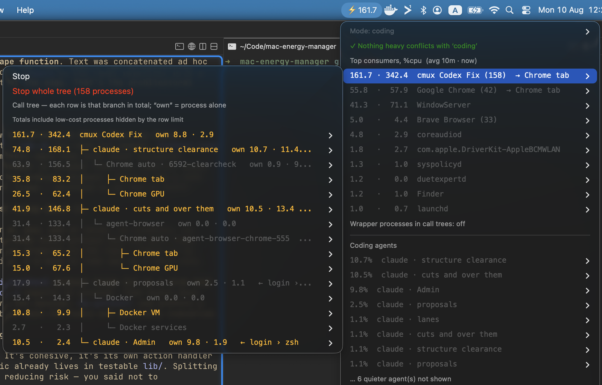

# mac-energy-manager

**A macOS menu-bar monitor that tells you *which process* is draining the battery — and
lets you stop it in one click.**

macOS ships two tools and neither answers the question. The battery menu names *apps*, so
"Google Chrome" is as specific as it gets. Activity Monitor knows more but never tells you
anything — you have to go and look, which means you look after the fan has been screaming
for an hour.



Ranked by what each process **and everything it spawned** cost together, over a rolling
10-minute average — so a spike doesn't reorder the list and a sustained hog stays on top.
Open any row for the call chain behind the number, with a Stop button on every node.

In the shot above, `cmux` is burning 161.7% — and the tree says why: two agent sessions,
each driving an automation Chrome that nobody is looking at, one of them costing 63.9% on
its own. That is the question this tool exists to answer, and none of it is visible in
the battery menu.

Plain `awk` over one `ps` call. No daemon, no kernel extension, no network access.

---

## Install

Requires macOS and [SwiftBar](https://swiftbar.app) (free, open source).

```sh
brew install --cask swiftbar
git clone https://github.com/Poglavar/mac-energy-manager.git
cd mac-energy-manager && ./install.sh
```

The ⚡ appears within about ten seconds (the first render says `collecting…` — it needs two
samples before it can show a rate).

`install.sh` **symlinks** the plugin into whatever plugin folder SwiftBar already uses, so
other plugins keep working and `git pull` updates this one in place. It also installs two
background timers; `--no-timers` skips them:

```sh
bin/browser-reap   --install 300     # clean up leaked automation browsers, every 5 min
bin/energy-advisor install 1800      # swap exhaustion / unattended drain, every 30 min
```

Uninstall: delete the symlink from SwiftBar's plugin folder, then `bin/browser-reap
--uninstall` and `bin/energy-advisor uninstall`.

**Permissions.** Only two things need one, and both degrade gracefully: Chrome *tab
titles* need Automation permission (granted from the menu; killing Chrome processes never
does), and Docker database attribution needs `docker ps` to work as your user.

---

## The menu

**⚡ title** — the heaviest tree's 10-minute average, plus `⚠` when something is running
that doesn't match your current mode.

**Mode: reading / coding / surfing** — flags processes that are yours, actually drawing
power, and not expected for that activity, with Stop on each. Each mode is one regex in
`mode_allow()`; add a `case` branch for your own.

**Top consumers** — one row per top-level process. Two numbers: `avg 10m · now`, both able
to exceed 100 on multiple cores. `→` names the biggest single process inside the tree, so
the obvious next question is answered before you open anything. Processes under `ROOT_MIN`
(1%) get no row — that tail is the machine idling.

Open a row for its **call tree**. Each line carries what *that whole branch* costs; `own`
appears when a process's personal cost differs. `←` is a *via* crumb: idle wrappers
(`login`, `zsh`, `npm run`) collapse into it rather than taking rows, which **Wrapper
processes in call trees: on/off** expands back.

**There is one Stop, not a SIGTERM/SIGKILL pair.** Those aren't a choice, they're a
sequence: SIGTERM lets a process flush buffers, release locks and save state, and SIGKILL
exists for the ones that ignore it. Stop sends SIGTERM, waits ~2.5 s, and escalates only
if needed — the same contract as `docker stop`. The root also has **Stop whole tree**,
which signals every pid leaves-first; otherwise you stop a parent, the children carry on,
and the number you clicked doesn't go away.

**Coding agents** — any agent CLI running under your terminal (claude, codex, copilot,
aider and anything else, found by walking the process tree rather than by name). Two
actions, because they're different intentions rather than an escalation: **Cancel current
turn (Ctrl-C)** leaves it running, **Quit agent** ends it. Quiet agents are hidden — an
open session waiting on you costs nothing, and a wall of `0.0%` rows buries the busy one.

**Chrome** — heavy renderer/GPU processes of the browser *you* launched (killing a
renderer is safe: "Aw, Snap", then the tab reloads with its state), plus open tabs by
title with **Close tab** once Automation permission is granted. Other Chromium browsers
(Brave, Edge, VS Code's Electron) appear in Top consumers with helpers named by role.

**Automation browsers** — see below.

**Keep-awake** — active `caffeinate` assertions with a **Force-release all**, so the Mac
can idle-sleep again.

**Power subsystems** — Bluetooth and Handoff state, with links to the Settings panes.

**Alerts** — the last five posted alerts, kept because macOS banners vanish.

---

## Fullscreen call graph

The menu is a 12-row list; some questions need the whole forest.

```sh
bin/energy-graph open        # start if needed, open in the browser
bin/energy-graph serve 9000  # foreground on a chosen port
bin/energy-graph json 2.0    # the current graph as JSON
bin/energy-graph stop
```

A process is drawn only if its *whole subtree* clears the threshold, so the parents of a
hog are never cut away from it. Colour is branch magnitude in five **absolute** bins, so a
branch keeps its colour between refreshes. Hover any node for its subtree total, own cost,
pid, full call chain and command line; **Table** is the same data as sortable text.

It is a **reader, not a second sampler** — the same `lib/*.awk` over the same history the
plugin writes, so the two can't disagree. It says so in red when the samples go stale
rather than presenting old averages as current. Binds `127.0.0.1` only.

### `load` — "is this machine busy, and who by?"

One `ps` and one awk pass, ~40 ms, for other tools to poll:

```sh
bin/energy-graph load
curl -s 127.0.0.1:8787/load.json?top=3
```

```json
{ "busyPct": 365.9, "cores": 8, "busyPerCore": 0.457, "loadAvg1": 6.93,
  "top": [ { "cpu": 85.6, "name": "Chrome GPU" } ] }
```

**Why:** a performance number measured on a contended machine is not a measurement. The
inflation lands on whichever frame or query was scheduled against the competing work, so
it looks exactly like an intermittent regression in whatever you just changed. Have your
benchmark record what else was running. CORS is echoed only for anchored localhost
origins — a wildcard would let any site you visit enumerate your processes.

---

## Automation browsers

A browser left running by a script is the most expensive unattributed thing on a developer
Mac — one was measured at **178% CPU across 10 processes** rendering a page nobody was
looking at. macOS reparents it to `launchd` within milliseconds, and it's *called* "Google
Chrome", so it looks exactly like your browser.

The discriminator throughout: **a browser whose `--user-data-dir` is in a temp location is
automation.** Your real browser keeps its profile in `~/Library/Application Support` and
can never be mistaken for one.

**Finding the owner.** Four signals, strongest first, each with the same guard — the
claimed owner must still be alive *and* its start time must still match, or the row is
refused rather than grafting a browser tree onto a recycled pid:

| signal | evidence |
|---|---|
| **launch stamp** | `bin/browser-stamp` records the owner at launch, the only moment the link exists |
| **remembered parent** | an edge the sampler actually witnessed, before the parent exited |
| **environment** | a process's env is copied at `fork()` and never rewritten, so session variables survive reparenting — this even survives `open -a`, and needs no cooperation at all |
| **responsible process** | macOS maintains one per pid for TCC; resolves to the app |

The environment path is what covers Playwright and Puppeteer, which will never call
`browser-stamp`. **Only identity variables are read out of an environment**, one pid at a
time — a unit test enforces the whitelist. Answers are cached by `(pid, start)` including
misses, so steady-state cost is nil.

**Seeing what they're doing.** The menu lists each automation browser with its owner, its
process count, and the pages it has open — read over CDP via `DevToolsActivePort`, which
works even for `--remote-debugging-port=0` and needs no permission.

**Reaping them.** They don't sit quietly: they keep rendering, and accumulate until the
machine crawls (one measurement: **load average 74 on 8 cores** from 13 leftovers, which
also made a test suite flaky). Asking the script to clean up isn't enough — one that
crashes never gets the chance.

```sh
browser-reap --status        # what's running, how idle, whose, and when it dies
browser-reap --dry-run       # what would die
browser-reap --report        # what it has killed, and what that was costing
browser-reap --install 300   # run it every 5 minutes under launchd
```

**It reaps on idle time, not age or ownership** — both were tried and both were wrong. Age
punishes a browser in constant use; owner liveness is nearly a constant when a session
runs for days, so it hands every forgotten browser an unlimited lease. Measured over **417
real browser lifetimes**: 87% receive two or more commands (so browsers really are
reused), but the median idle gap is **1.2 min** and p90 is 7.5 — so 15 minutes of idle is
finished with overwhelming probability, and doubling the wait spares barely 1% more.

Two fallbacks: `--ttl 45` on total age for browsers nothing reports usage for (a browser
with no record is *unknown*, not garbage — a long test run must not be shot in the back),
and `--orphan-ttl 5` when the owner has exited. A ledger at
`~/Library/Logs/browser-reap.log` gets a line on **every** run, including quiet ones, so a
silent reaper is distinguishable from a broken one.

Known gap: Firefox/WebKit automation uses `-profile`, not `--user-data-dir`.

---

## Alerts

Two conditions, checked every 30 minutes, both deterministic:

- **Swap is nearly gone and still being written to.** The rest of this tool is CPU-only,
  and CPU is the wrong number for the failure that actually makes a Mac unusable: once
  swap fills, everything stalls on disk while the ⚡ figure stays unremarkable. The alert
  names the programs holding the memory, with helpers rolled into their app.
- **Something expensive is running while you're away.** Sustained across consecutive runs,
  not one sample, and automation browsers are excluded because the reaper handles those.

```sh
bin/energy-advisor explain    # what the triggers see, and whether any fires
bin/energy-advisor messages   # the last five posted alerts
```

Thresholds live in `~/.config/energy-manager/advisor.json`. Use `explain` to tune them
instead of guessing.

This replaced an LLM asked "is anything wrong?" every five minutes: across **2,824 runs it
wanted to warn 741 times (26%)**, 20 got through the confidence gate, and **not one was
ever acted on**. Detection is not a judgement call — it's a threshold on a number, and a
rule you can read, test, and deliberately make fail.

---

## Security and privacy

Nothing leaves the machine: no telemetry, no account, no API key, and **no package
manager anywhere in the project** — no npm, pip or cargo, no lockfile, no vendored
library. For a tool that reads every process on your Mac, that absence is the point:
there is no transitive dependency to be compromised.

It needs **no elevated privileges** and asks for exactly one optional permission (Chrome
tab titles). It signals only processes you already own.

Two hardening decisions worth knowing about, both prompted by verified findings:

- **Menu text is escaped.** A SwiftBar line is `text | key=value`, and `bash=` makes a
  row run a command — so a `|` in a window title (which any web page controls) was
  arbitrary code execution one click away. Labels are sanitised at a single boundary,
  and the render additionally **refuses to publish** a payload containing an action it
  didn't write.
- **The graph server validates `Host`.** Binding to `127.0.0.1` is not enough: DNS
  rebinding makes an attacker's page same-origin, so CORS never applies. It serves full
  command lines, which routinely carry API keys, so anything but a localhost `Host` gets
  403 — plus CSP `default-src 'none'`.

The alert checker reads only which app is frontmost, never what is on screen. See
[docs/design-notes.md](docs/design-notes.md) for the full reasoning.

## Optional integrations

Everything above works standalone. Two things light up if you happen to use them:

- **[cmux](https://cmux.sh)** — agent sessions get named by their tab (`claude · fix the
  tile cache`) instead of by session id, which is the one thing about a session you never
  chose.
- **Docker** — when a container publishes Postgres to the Mac, established sockets are
  matched back to host pids and drawn as a separate **causal** link, so work done *through*
  a database is connected to the process that caused it. It never changes CPU totals or
  kill lists.

## Configuration

Knobs at the top of `plugins/energy.10s.sh`:

| Knob | Default | Meaning |
|---|---|---|
| `TOP_N` | 12 | top-level processes listed |
| `WINDOW` | 600 | rolling average window, seconds |
| `ROOT_MIN` | 1 | a top-level process below this gets no row |
| `TREE_MIN` | 0.3 | hide branches cheaper than this *inside* a call tree |
| `MAX_TREE_ROWS` | 24 | per-tree row budget; the threshold self-raises to fit |
| `ELIDE_MAX` | 0.5 | a link this cheap is plumbing — collapse it into a `←` crumb |
| `HOG_MIN` | 3 | self-cost at which a node is called out as a hotspot |
| `AGENT_MIN` / `AGENT_MAX` | 0.5 / 8 | floor and cap for the agent list |

Rename the plugin file to change the refresh rate (`energy.30s.sh`). **Not below 10s**: a
render that outlives its interval is cancelled and its output discarded.

## How it works

Each render diffs every process's cumulative CPU time (`ps -axo cputime`, ~100 ms) against
the previous snapshot: `cpu% = Δcputime / Δwallclock`. **Each SwiftBar refresh is the
sampler** — there is no background collector. `top -l 2` is deliberately avoided: it takes
~2.2 s, hangs without a tty, and SwiftBar kills plugin-spawned children. CPU% over the
interval tracked macOS's own Energy Impact to within ~1% here; the trade-off is that idle
wake-ups and GPU aren't weighted the way Energy Impact weights them.

```
plugins/energy.10s.sh   sampling, menu rendering, click actions
bin/energy-graph        fullscreen call-graph viewer (CLI + local server)
bin/energy-advisor      periodic alert checker
bin/browser-stamp       record who launched an automation browser, at launch
bin/browser-reap        kill leaked automation browsers on a timer
bin/agent-browser       PATH wrapper that stamps agent-browser sessions
lib/tree.awk            process forest, subtree energy, call chains, ranking
lib/attribution.py      owners macOS still knows: env, responsible process, pgid
lib/cdp.sh              what each automation browser has open
lib/*.awk               labelling, parent memory, Chrome roles, agents, Docker links
web/graph.html          the graph page
```

Deeper design notes — why the tree must be rebuilt rather than read, the SwiftBar failure
modes the render is shaped around, and the measurements behind each threshold — are in
[docs/design-notes.md](docs/design-notes.md).

## Tests

```sh
test/run-tests.sh              # 97 headless assertions, ~2s
python3 test/test_advisor.py
python3 test/test_attribution.py
```

`lib/` takes TSV in and emits TSV out — it never calls `ps` itself — so the whole
process-forest algorithm is testable from fixtures with no SwiftBar and no menu bar. The
fixtures encode the shapes that actually caused trouble: a process buried under three
shell wrappers, a browser and its helpers, a worker whose parent has exited, a recycled
pid, Docker's launchd-parented VM.

Every assertion has been checked to **go red** when the logic behind it is broken. A test
that cannot fail is decoration, not a safety net.

## License

MIT — see [LICENSE](LICENSE).
